# Triumph Bonneville T120 (2018) — Workshop Explorer

> **Open in your browser (no install, share the link):**
> **[Workshop Explorer](https://jsankr.github.io/TriumphBonnevilleT120/)** · **[Engine X-ray (3D, animated)](https://jsankr.github.io/TriumphBonnevilleT120/engine-xray.html)** · [Teardown](https://jsankr.github.io/TriumphBonnevilleT120/exploded.html) · [Parts catalogue](https://jsankr.github.io/TriumphBonnevilleT120/catalogue.html) · [Electrical](https://jsankr.github.io/TriumphBonnevilleT120/electrical.html) · [Manual index](https://jsankr.github.io/TriumphBonnevilleT120/manual-index.html)

<p align="center">
  <a href="https://jsankr.github.io/TriumphBonnevilleT120/engine-xray.html">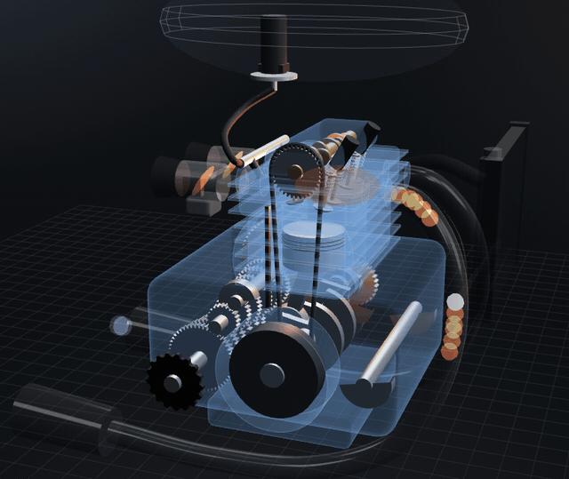</a><br>
  <sub><b>Engine X-ray.</b> The 270° twin firing in real time: fuel flow, injector spray, spark, combustion and exhaust. Concept drawing, not Triumph CAD and not to scale.</sub>
</p>

A free, browser-only workshop companion for the **2018 Triumph Bonneville T120** (liquid-cooled 1200 HT). It covers the air-cooled 2014–2016 Bonneville and T100 as well. Every torque, part and specification is shown with the source and page it came from. Nothing is invented, and anything that cannot be confirmed for a 2018 bike says so.

## What's covered

| | |
|---|---|
| [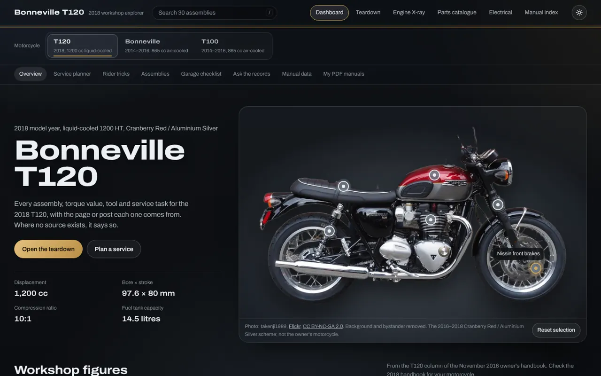](https://jsankr.github.io/TriumphBonnevilleT120/) **[Dashboard](https://jsankr.github.io/TriumphBonnevilleT120/)**: key specifications, the service planner, a torque quick reference, the maintenance schedule, the garage checklist and a sourced question box. | [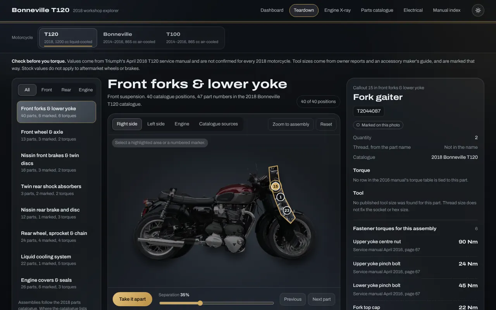](https://jsankr.github.io/TriumphBonnevilleT120/exploded.html) **[Teardown](https://jsankr.github.io/TriumphBonnevilleT120/exploded.html)**: real T120 photos you can take apart assembly by assembly, with callouts linked to the fastener torques for each assembly. |
| [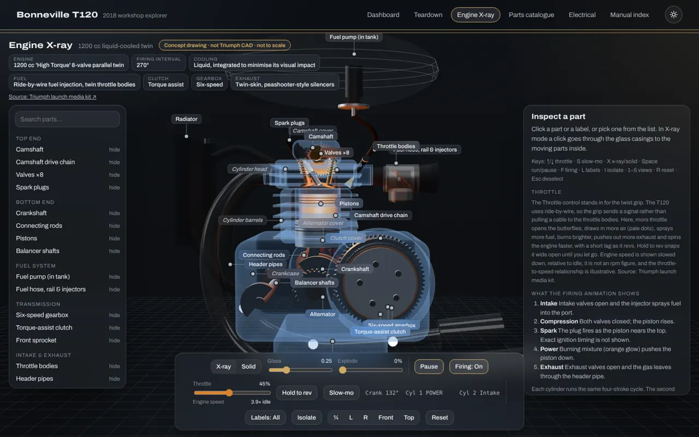](https://jsankr.github.io/TriumphBonnevilleT120/engine-xray.html) **[Engine X-ray](https://jsankr.github.io/TriumphBonnevilleT120/engine-xray.html)**: an animated 3D concept of the twin with glass casings. It has a throttle, firing, fuel and exhaust flow, labelled parts with sources, explode and isolate. | [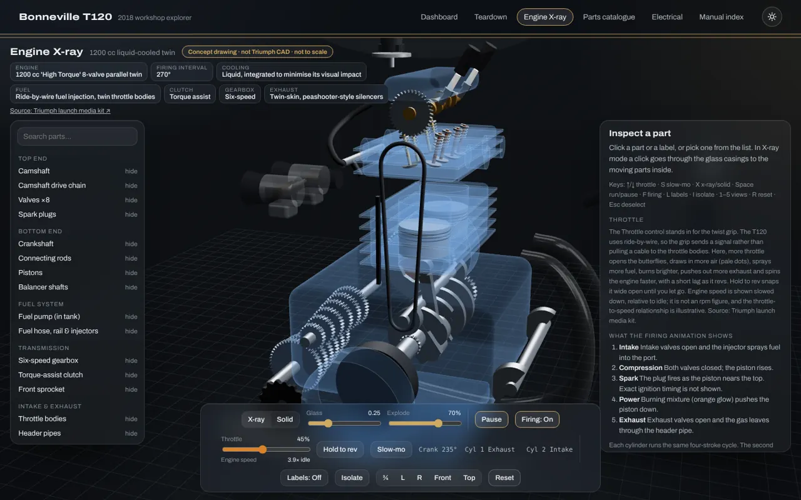](https://jsankr.github.io/TriumphBonnevilleT120/engine-xray.html) **Explode and inspect**: pull the engine apart along clear paths and put it back, click any part for its sourced description, or switch to a solid view. |
| [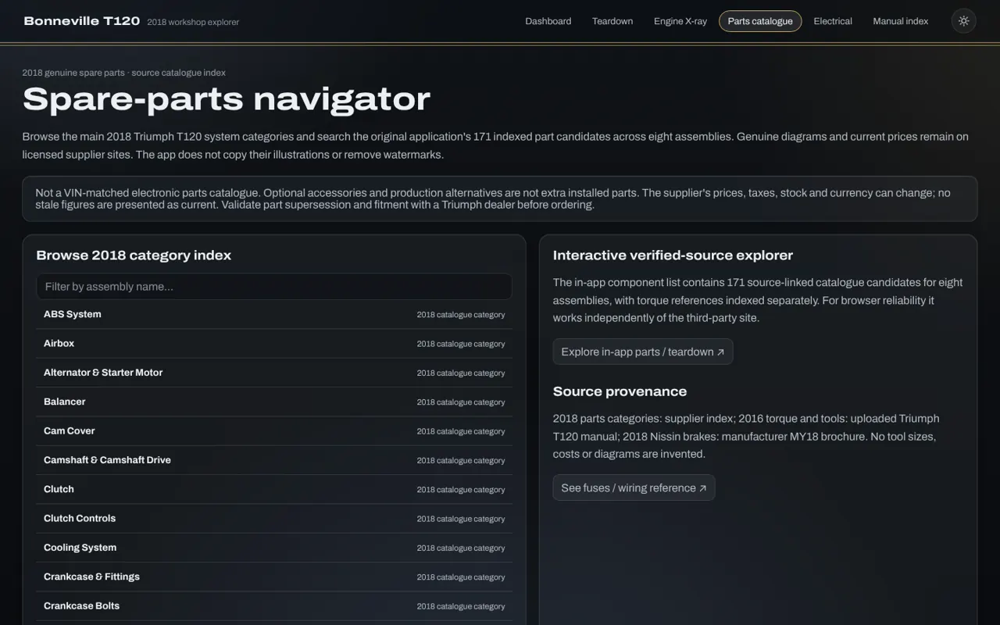](https://jsankr.github.io/TriumphBonnevilleT120/catalogue.html) **[Parts catalogue](https://jsankr.github.io/TriumphBonnevilleT120/catalogue.html)**: 2018 assemblies and part candidates, with links to the genuine catalogue diagrams. Check fitment against your VIN. | [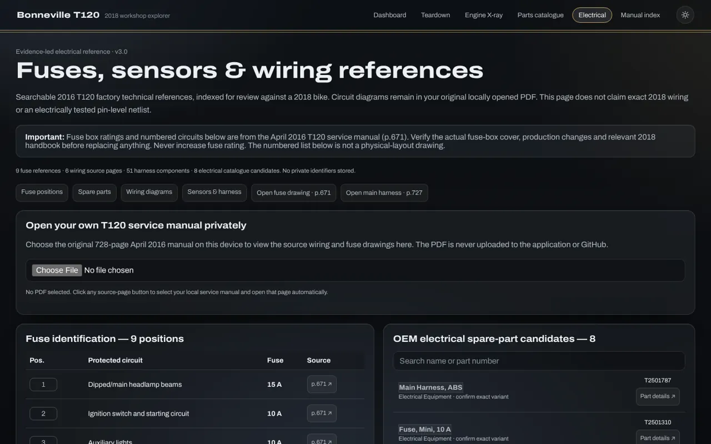](https://jsankr.github.io/TriumphBonnevilleT120/electrical.html) **[Electrical](https://jsankr.github.io/TriumphBonnevilleT120/electrical.html)**: fuses, sensors and wiring references indexed to the manual pages. Open your own PDF privately in the browser. |
| [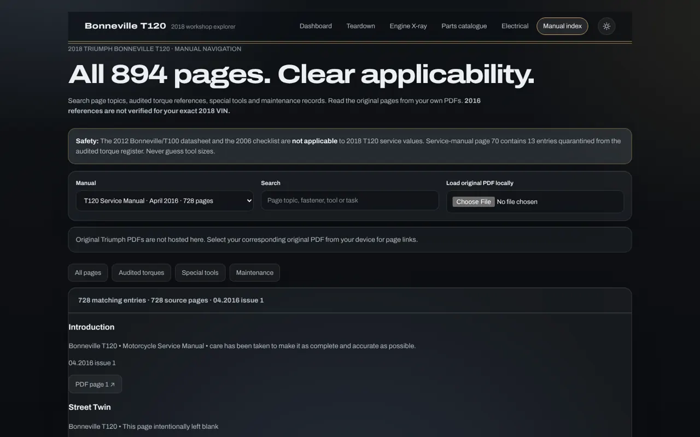](https://jsankr.github.io/TriumphBonnevilleT120/manual-index.html) **[Manual index](https://jsankr.github.io/TriumphBonnevilleT120/manual-index.html)**: all 894 pages of the 2016 service manual and owner's handbook, indexed by topic. It shows where to look, but the PDFs are never hosted. | [](https://jsankr.github.io/TriumphBonnevilleT120/real-photo-gallery.html) **[Real photos](https://jsankr.github.io/TriumphBonnevilleT120/real-photo-gallery.html)**: an atlas of real T120 photographs and OEM exploded drawings, linked to their publishers with credits. None of them shows your own bike. |
| [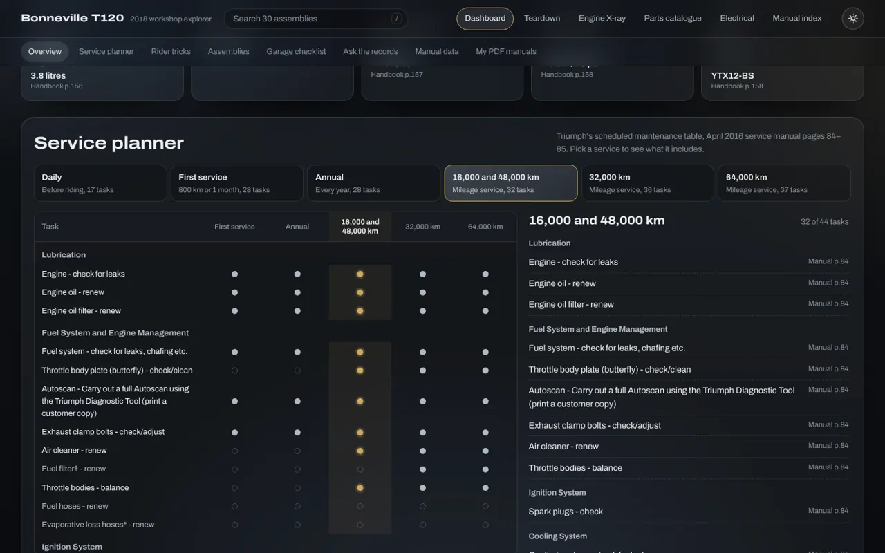](https://jsankr.github.io/TriumphBonnevilleT120/#servicePlanner) **[Service planner](https://jsankr.github.io/TriumphBonnevilleT120/#servicePlanner)**: Triumph's maintenance schedule as a task list for each interval, with the manual page for every task. | [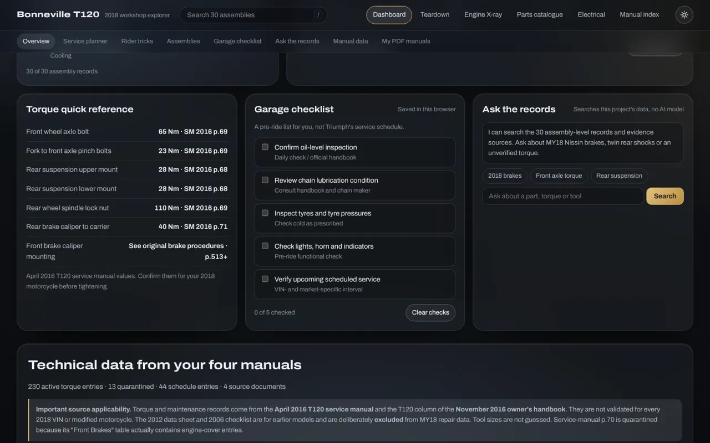](https://jsankr.github.io/TriumphBonnevilleT120/#torqueReference) **[Torque quick reference](https://jsankr.github.io/TriumphBonnevilleT120/#torqueReference)**: search 230 torque values from the 2016 manual by fastener, each with its page. Contradictory rows are kept out. |

<p align="center">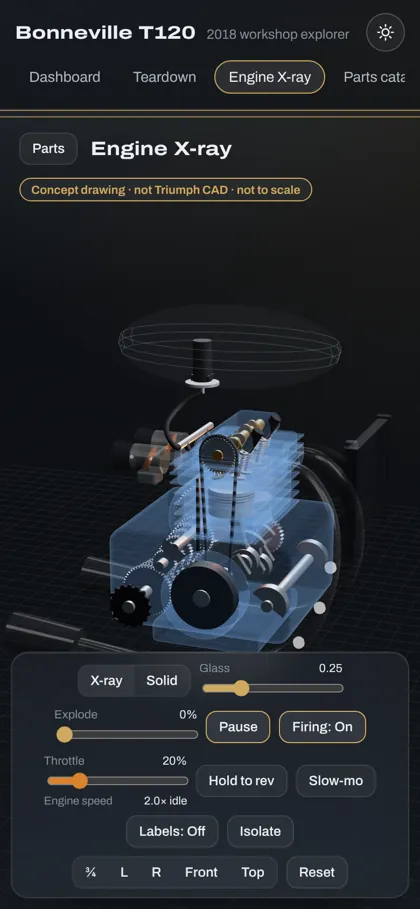 &nbsp; 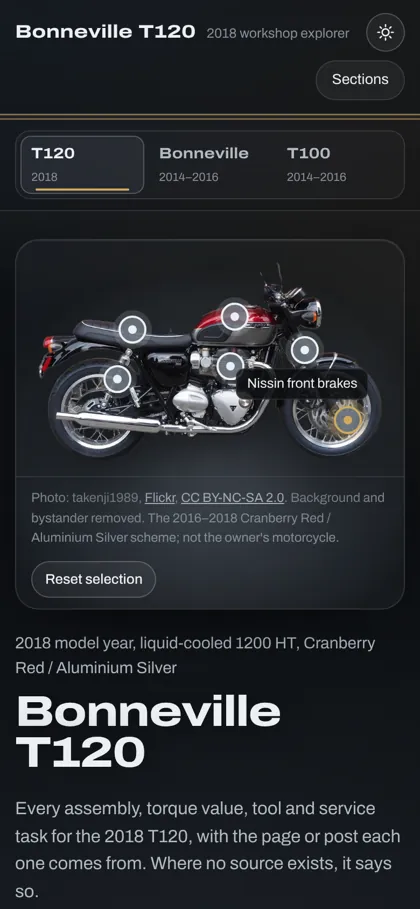<br><sub>Works on phones too.</sub></p>

## How it helps a Bonneville rider

- **Before you pick up a spanner:** look up the torque for the exact fastener you are about to touch, with its manual page, then open your own copy of the manual to that page and check it.
- **When the service is due:** the planner shows what each interval (first service, annual, 16,000 / 32,000 / 48,000 km and more) asks for, so you can do it yourself or check the dealer's invoice.
- **When you need a part:** the Teardown and Parts catalogue show which assembly a part belongs to and link to the genuine diagram, so you can order by part number instead of by description.
- **When something looks wrong:** the Rider tricks below explain the things that only look like faults, and the Electrical page points you to the right fuse and wiring pages.
- **To understand your engine:** the Engine X-ray shows how the 270° twin, its two balancer shafts, its fuel system and its ride-by-wire throttle work together. It also shows which side the clutch (left) and the alternator and sprocket (right) are on.
- **Private by design:** it runs entirely in your browser. It needs no VIN and stores none, and manual PDFs you open stay on your device.

## Torque quick reference (2018 T120)

The fasteners riders touch most often, taken exactly from the **April 2016 T120 service manual** torque tables. All 230 values are searchable in the app's [Torque quick reference](https://jsankr.github.io/TriumphBonnevilleT120/#torqueReference).

> **Check before you tighten.** These are 2016 edition values, not independently validated for a 2018 or India-market VIN. Torques belong to the named fastener, so follow the procedure on the page shown, including any new fixings or sealing washers. Front brake caliper values are **not listed**, because the manual's page 70 "Front Brakes" table prints unrelated rows. Those 13 rows are quarantined; use the front brake procedures from p. 513.

<!-- torque-table:start (generated from data/source-reference.json; checked by tests/validate-readme-torques.mjs) -->
| Area | Fastener (manual wording) | Torque | Manual page | Note | Row ID |
|---|---|---|---|---|---|
| Engine, oil and cooling | Sump plug | **25 Nm** | p. 60 | Fit new sealing washer(s) | `SM2016-P60-R12` |
| Engine, oil and cooling | Oil filter | **10 Nm** | p. 62 | Apply clean engine oil to the seal(s) | `SM2016-P62-R4` |
| Engine, oil and cooling | Spark plugs | **12 Nm** | p. 57 |  | `SM2016-P57-R9` |
| Engine, oil and cooling | Camshaft cover to cylinder head | **14 Nm** | p. 57 | See Camshaft Cover - Installation, page 104 | `SM2016-P57-R1` |
| Engine, oil and cooling | Coolant expansion tank | **4 Nm** | p. 64 |  | `SM2016-P64-R3` |
| Chain and sprockets | Drive chain slack adjuster lock nut | **20 Nm** | p. 68 |  | `SM2016-P68-R3` |
| Chain and sprockets | Front sprocket to output shaft nut | **180 Nm** | p. 61 | Fit new fixing(s) if loosened or removed | `SM2016-P61-R1` |
| Chain and sprockets | Rear sprocket to sprocket carrier | **55 Nm** | p. 69 | Fit new fixing(s) if loosened or removed | `SM2016-P69-R4` |
| Chain and sprockets | Front sprocket cover to crankcase | **9 Nm** | p. 60 |  | `SM2016-P60-R7` |
| Wheels | Front wheel spindle/axle bolt | **65 Nm** | p. 69 |  | `SM2016-P69-R1` |
| Wheels | Fork to wheel spindle pinch bolts | **23 Nm** | p. 69 |  | `SM2016-P69-R2` |
| Wheels | Rear wheel spindle lock nut | **110 Nm** | p. 69 |  | `SM2016-P69-R3` |
| Rear brake | Brake caliper to carrier | **40 Nm** | p. 71 |  | `SM2016-P71-R8` |
| Rear brake | Brake disc to wheel | **22 Nm** | p. 71 | Fit new fixing(s) if loosened or removed | `SM2016-P71-R9` |
| Rear brake | Brake hose to rear caliper | **25 Nm** | p. 71 | Fit new sealing washer(s) | `SM2016-P71-R1` |
| Steering, bars and controls | Handlebar clamp bolt | **24 Nm** | p. 67 |  | `SM2016-P67-R7` |
| Steering, bars and controls | Handlebar risers | **38 Nm** | p. 67 |  | `SM2016-P67-R14` |
| Steering, bars and controls | Upper yoke pinch bolt | **24 Nm** | p. 67 |  | `SM2016-P67-R2` |
| Steering, bars and controls | Lower yoke pinch bolt | **45 Nm** | p. 67 |  | `SM2016-P67-R3` |
| Steering, bars and controls | Upper yoke centre nut | **90 Nm** | p. 67 |  | `SM2016-P67-R1` |
| Steering, bars and controls | Fork top cap | **22 Nm** | p. 67 |  | `SM2016-P67-R16` |
| Steering, bars and controls | Gear change pedal pinch bolt | **8 Nm** | p. 61 |  | `SM2016-P61-R10` |
| Steering, bars and controls | Mirror | **20 Nm** | p. 73 |  | `SM2016-P73-R20` |
| Rear suspension | Swinging arm pivot nut | **110 Nm** | p. 68 | See Swinging Arm - Installation, page 512 | `SM2016-P68-R1` |
<!-- torque-table:end -->

<details>
<summary><b>🥚 Easter egg: 22 rider tricks most T120 owners never find</b> (tap to open)</summary>

<br>
<a href="https://jsankr.github.io/TriumphBonnevilleT120/#riderTips">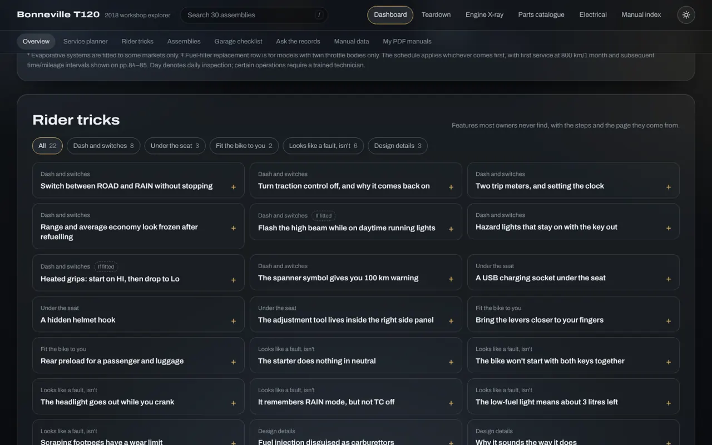</a>

Each trick has step-by-step instructions, any caution, and the page it comes from, in the **[Rider tricks](https://jsankr.github.io/TriumphBonnevilleT120/#riderTips)** section of the dashboard. Nothing here unlocks hidden ECU or dashboard menus, and dealer-only resets are marked as dealer-only.

**Dash and switches**

- Switch between ROAD and RAIN without stopping <sub>(Triumph owner's handbook, p. 44–47, 55)</sub>
- Turn traction control off, and why it comes back on <sub>(Triumph owner's handbook, p. 48–49)</sub>
- Two trip meters, and setting the clock <sub>(Triumph owner's handbook, p. 42–43)</sub>
- Range and average economy look frozen after refuelling <sub>(Triumph owner's handbook, p. 41–42)</sub>
- Flash the high beam while on daytime running lights <sub>(Triumph owner's handbook, p. 37, 57–58)</sub>
- Hazard lights that stay on with the key out <sub>(Triumph owner's handbook, p. 56)</sub>
- Heated grips: start on HI, then drop to Lo <sub>(Triumph owner's handbook, p. 58–59)</sub>
- The spanner symbol gives you 100 km warning <sub>(Triumph owner's handbook, p. 98)</sub>

**Under the seat**

- A USB charging socket under the seat <sub>(Triumph owner's handbook, p. 72, 76)</sub>
- A hidden helmet hook <sub>(Triumph owner's handbook, p. 70, 72)</sub>
- The adjustment tool lives inside the right side panel <sub>(Triumph owner's handbook, p. 69)</sub>

**Fit the bike to you**

- Bring the levers closer to your fingers <sub>(Triumph owner's handbook, p. 60–62)</sub>
- Rear preload for a passenger and luggage <sub>(Triumph owner's handbook, p. 131–132)</sub>

**Looks like a fault, isn't**

- The starter does nothing in neutral <sub>(Triumph owner's handbook, p. 56)</sub>
- The bike won't start with both keys together <sub>(Triumph owner's handbook, p. 55)</sub>
- The headlight goes out while you crank <sub>(Triumph owner's handbook, p. 58)</sub>
- It remembers RAIN mode, but not TC off <sub>(Triumph owner's handbook, p. 47–48)</sub>
- The low-fuel light means about 3 litres left <sub>(Triumph owner's handbook, p. 38, 40, 162)</sub>
- Scraping footpegs have a wear limit <sub>(Triumph owner's handbook, p. 133)</sub>

**Design details**

- Fuel injection disguised as carburettors <sub>(Triumph launch press kit)</sub>
- Why it sounds the way it does <sub>(Triumph specification page)</sub>
- The name goes back to 1959 <sub>(Triumph launch press kit)</sub>
</details>

## v3.4 — Engine X-ray concept explainer (18 November 2026)

[**Open the Engine X-ray**](https://jsankr.github.io/TriumphBonnevilleT120/engine-xray.html) ([source](engine-xray.html)) — an animated 3D drawing of the 1200 cc liquid-cooled twin with its casings shown as glass. It shows how the parts move together: crank, rods and pistons on the 270° firing interval, camshaft at half speed, valves, two balancer shafts, clutch and six-speed gearbox.

**Firing and fuel.** The fuel pump in the tank (tank drawn as an outline) feeds the fuel hose and the rail on the cylinder head; dots show the fuel flowing. Each injector sprays during its cylinder's intake stroke, the plug sparks near top dead centre, an orange flame fills the chamber on the power stroke, and exhaust gas flows down the header pipe and out of the silencer. The readout names each cylinder's stroke, with the second cylinder 270° behind the first. In X-ray mode the header pipes and radiator are drawn see-through so the flow is visible. *Firing: On/Off* (key F) switches the effects.

**Throttle (v3.5).** A Throttle control (↑/↓ keys) stands in for the ride-by-wire twist grip. It opens the butterflies in the throttle bodies, draws in more intake air (pale dots), and increases fuel spray, flame and exhaust, and the engine speeds up with a short lag, all while firing stays on. *Hold to rev* snaps it wide open until you let go, and *Slow-mo* (key S) slows the view for study. Labels start hidden for a clean view; *Labels* (key L) cycles Off → Internals → All, and a selected part always shows its label. Engine speed is shown slowed down, relative to idle, never as rpm. Injection and ignition timing are illustrative; the pump, hose and rail come from the 2016 manual's fuel-system torque rows (p.65). You can switch between X-ray and solid, change the glass opacity, explode the engine apart and back, isolate a part and pick camera views.

**It is a concept drawing, not Triumph CAD.** Shapes, sizes and positions are hand-built and not to scale, and the page says so on screen. Each part's text names its source: Triumph's launch media kit (1200 cc 8-valve High Torque twin, 270° firing interval, liquid cooling, ride-by-wire injection, torque-assist clutch, six-speed gearbox, twin-skin peashooter exhausts) or a page in the 2016 service manual's chapter and torque-table rows already recorded in `data/source-reference.json` (for example the Balancer chapter and the front balancer / rear dead shaft rows that show two balancer shafts). Where a detail is not sourced, such as which side the cam chain runs on, the text says it is illustrative. The page carries no torque values, tool sizes, dimensions or part numbers; `tests/validate-engine-xray.mjs` fails the build if any appear.

Files: `engine-xray.html`, `engine-xray.js`, `engine-xray.css`, `data/engine-xray.json`. Three.js r160 (MIT) and four of its add-ons are vendored in `assets/vendor/three/`, so the page loads no third-party scripts and its CSP is `script-src 'self'`.

## v3.3 — Rider tricks (18 November 2026)

A new dashboard section for the T120 lists 22 features most owners never find, each with steps, a caution where needed, and the page it comes from. Examples: changing between ROAD and RAIN on the move, turning traction control off (and why it always comes back on), flash-to-pass with daytime running lights, hazards that stay on with the key out, heated grips, the USB socket and helmet hook under the seat, lever span and rear preload settings, and the design details behind the carburettor-styled throttle bodies and the 270° twin.

Source: Triumph's owner's handbook 3855663-EN, which Triumph's handbook service lists for the 2018 T120, plus Triumph's launch press kit and specification page, and one Visordown road test as a cross-check. Nothing here unlocks hidden ECU or dashboard menus. No such menu is documented for this model, and dealer-only resets (the service symbol) are named as dealer-only.

## v3.2 — three motorcycles: T120, air-cooled Bonneville and T100 (18 November 2026)

A switch under the header picks the motorcycle. The dashboard and the teardown follow it, and the choice is kept in the address (`?model=`) and in this browser. The T120 is unchanged.

| Model | Years | Teardown photo | Parts catalogue | Torques |
|---|---|---|---|---|
| Bonneville T120 | 2018 | three photos | 2018 catalogue | April 2016 T120 service manual |
| Bonneville (A3) | 2014–2016, 865 cc air-cooled | 2014 Bonneville, right side | Model year 2015, 195 part rows | 38 values |
| Bonneville T100 (A3) | 2014–2016, 865 cc air-cooled | 2011 T100, right side | Model year 2015, 237 part rows | 38 values |

**Where the air-cooled data comes from.** No Triumph service manual for these models was available, so every torque carries one of three source tiers, shown as a badge next to the value:
- **Triumph documents.** The owner's handbook 3851861-IN (January 2015), for specifications, the maintenance chart, 85 Nm rear spindle nut and 5 Nm chain adjusters. Triumph Technical News 162 (March 2015, published by NHTSA), which changes the clutch and alternator cover bolts to 8 Nm and the chain from 525 to 520 at VIN 694352.
- **Aftermarket.** The Haynes manual torque table, as reproduced by Moto Usher. It supplies most chassis and brake values. Where Haynes contradicts itself (front master cylinder clamp, 12 or 15 Nm) or was superseded by Triumph (cover bolts), both figures are shown.
- **Owner forum.** One New Bonneville Riders post quoting factory figures, used only as a cross-check.

Part numbers come from the model-year 2015 catalogue at Hermy's Triumph eStore, an authorised dealer, with a link to each diagram. Prices are not stored. One tool size is published: a 22 mm spanner for the M16 wheel spindle nut, from an aftermarket axle-nut listing. Owner posts giving 24 mm could not be re-read, so they are not used.

**Not shown on the photos.** The rear brake is on the left side, and the oil cooler is hidden behind the frame tubes. Those assemblies still list every part and torque, and say why they are not marked. On these 865 cc twins the final drive chain and the badged alternator cover are on the right side, as the catalogue's "Cover RH" listing and the photographs show.

| Photo | Author | Licence | Changes |
|---|---|---|---|
| [2014 Triumph Bonneville](https://commons.wikimedia.org/wiki/File:2014_Triumph_Bonneville.jpg) | QK2222VX | [CC BY-SA 4.0](https://creativecommons.org/licenses/by-sa/4.0/) | Resized; hero cropped. `assets/photo/bonneville-2014-*.webp` are shared under CC BY-SA 4.0. Aftermarket mirrors, seat and indicators are fitted. |
| [Triumph Bonneville T100 (2011)](https://commons.wikimedia.org/wiki/File:Triumph_Bonneville_T100_(2011).jpg) | Hogyn Lleol | [CC BY-SA 4.0](https://creativecommons.org/licenses/by-sa/4.0/) | Resized; hero cropped. `assets/photo/t100-2011-*.webp` are shared under CC BY-SA 4.0. A 2011 bike of the same 865 cc generation, with a flyscreen and rack; no openly licensed 2014–2016 T100 side view was found. |

Neither photograph shows the owner's motorcycle.

**Link repair:** Previously linked OEM mirrors blocked some visitors. Use the in-app exploded callouts and two 2018 catalogue choices instead. External reachability is network-dependent.

## v3.1 — your paint scheme, light and dark glass themes (16 November 2026)

- **Cranberry Red / Aluminium Silver.** The dashboard and the default teardown view now use a real photograph of a T120 in the 2016–2018 Cranberry Red over Aluminium Silver scheme with the gold coach line, shot from the right (chain) side. Seven of the eight assemblies are outlined on it, with 19 markers for right-hand parts (right stanchion, right caliper, chain, clutch and sprocket covers). The rear brake is on the left, so it stays on the left-side photo.
- **Light and dark themes.** Graphite glass and frosted aluminium glass, with brass from the coach line as the only accent. The site follows the device setting until the visitor uses the switch in the header; the choice is remembered in that browser (`theme.js`). Text contrast is at least 5:1 for all body and label colours in both themes.
- Teardown now has three photographs: right side (Cranberry Red), left side, engine close-up.

| Photo | Author | Licence | Changes |
|---|---|---|---|
| [T120, Cranberry Red / Aluminium Silver, right side](https://www.flickr.com/photos/105592384@N07/51444289036) | takenji1989 | [CC BY-NC-SA 2.0](https://creativecommons.org/licenses/by-nc-sa/2.0/) | Background and the person standing behind the motorcycle removed; resized and cropped. The adapted files `assets/photo/t120-cranberry-*.webp` are shared under CC BY-NC-SA 2.0, so they may not be used commercially. |

## v3.0 — glass redesign and real-photo teardown (16 November 2026)

**[Open the dashboard](https://jsankr.github.io/TriumphBonnevilleT120/)** · **[Open the teardown](https://jsankr.github.io/TriumphBonnevilleT120/exploded.html)**

- **Teardown on real photographs.** The eight 2018 catalogue assemblies are outlined on two openly licensed photographs of the liquid-cooled T120 (left side, right-side engine). *Take it apart* lifts each assembly out of the photo; 24 numbered markers place individual catalogue callouts. Outlines and markers are hand-placed and approximate.
- **Each part shows its own torque and tool.** 31 callout-to-torque links tie a catalogue part to the April 2016 service-manual row that tightens it. Each link records why it was made and is labelled *named* (the manual or catalogue names the same component) or *inferred* (the project's reading). The full manual torque table for each system is one click away.
- **Tool sizes with sources.** Eight hand-tool sizes from owner forum posts and an accessory maker's install guide, each labelled with its source type and link (`data/tool-size-reports.json`). Triumph's own data files still hold no tool sizes.
- **Service planner.** Triumph's 44-task scheduled-maintenance table (service manual pp. 84–85) as an interactive matrix: pick Daily, First service, Annual, 16,000/48,000, 32,000 or 64,000 km to see what is due.
- **Workshop figures.** Oil, coolant, plug, fuel, tyre, chain, brake-fluid and battery figures from the T120 column of the 2016 owner's handbook, with page numbers.
- **Design.** Glass interface; typeface Archivo (SIL Open Font Licence, bundled in `assets/fonts`).
- **Tests.** New `tests/validate-teardown.mjs` checks the photo map and tool data against the parts catalogue and manual table; it runs in CI with the existing suites.

### Photographs and licences
| Photo | Author | Licence | Changes |
|---|---|---|---|
| [2017 Bonneville T120, left side](https://commons.wikimedia.org/wiki/File:2017_Bonneville_T120_CSNDCC1.jpg) | AmenMoto | [CC BY-SA 4.0](https://creativecommons.org/licenses/by-sa/4.0/) | Resized, background removed. The adapted file `assets/photo/t120-left-cutout.webp` is shared under CC BY-SA 4.0. |
| [T120 engine, right side](https://commons.wikimedia.org/wiki/File:Triumph_EM1B9077_(49794022932).jpg) | Bengt Nyman | [CC BY 2.0](https://creativecommons.org/licenses/by/2.0/) | Resized. |

Neither photograph shows the owner's motorcycle. The left-side photo is a 2017 model of the same liquid-cooled generation; the right-side photo's model year is not stated by the photographer.

This is an independent owner's reference, not affiliated with or endorsed by Triumph Motorcycles.

---


## v2.9 — electrical/fuse references, 2018 parts navigator and corrected torque panel

**[Electrical & Fuses](electrical.html)** is a searchable original-source reference for the 2016 T120 service-manual fuse table (9 positions), main harness sensor/component legend, and documented wiring pages (671, 724–728). Choose your own locally stored PDF to open original diagrams in the browser without copying them to GitHub. These references are **not certified for a 2018 VIN**; the actual 2018 fuse cover and manual take priority.

**[2018 Genuine Parts Navigator](catalogue.html)** indexes selected systems from the [2018 motorcycle supplier catalogue](https://www.motorcyclespareparts.eu/en/triumph-parts/2018-bonneville-t120-motorcycles). Genuine part metadata are candidate references; illustrations, watermarks and current seller checkout prices remain at the authorized provider. Use the [in-app exploded parts explorer](exploded.html) for the 171 existing sourced part candidates in eight assemblies.

**Dashboard fix:** selected-assembly torque values from the 2016 T120 manual now appear **before** the missing 2018-specific values. The label “2016 MANUAL REFS · CHECK MY18” clarifies that the application contains supporting torque records without claiming VIN-specific confirmation or undocumented tool socket/hex sizes. No private vehicle identifiers, third-party complete site copies or images with removed watermarks are included.

## NEW: 2018 OEM exploded teardown explorer (v2.7)

**[▶ Launch interactive exploded parts, tools and torque references](exploded.html)** · [Open as hosted page](https://jsankr.github.io/TriumphBonnevilleT120/exploded.html)

Eight 2018-specific sourced assembly fiches, 171 original catalogue entries grouped into numbered callouts (including conditional part alternatives) and 27 separately named tightening operations referencing the **April 2016 T120 service manual**. Includes front forks/yoke, both brakes (2018 Nissin), wheels, twin rear shocks, cooling and engine covers. Select a part, search OEM numbers, use the callout spread control or open the third-party genuine exploded drawing. The rendered parts-callout layout is **not measured physical CAD**. Exact socket/Allen/Torx bit sizes and individual 2018 VIN applicability remain unverified, and modified wheels/forks require their own sources. A confidential vehicle identifier is neither collected nor embedded. The original OEM technical drawings and copyrighted manuals are not copied into this repository.


## Verified 2018 photo and OEM parts source atlas — v2.5

[**Browse actual 2018 T120 example photos and OEM exploded diagrams**](real-photo-gallery.html) · [**Photo-based teardown studio**](photo-teardown.html) · [**MY18 manufacturer brochure**](https://www.triumph-motorcycles.com.vn/data/categories/897/TRM_10759398_MY18Classics_Master_US_SP.pdf)

Version 2.5 adds 13 externally sourced motorcycle image references (with year/aftermarket caveats), 11 source-linked 2018 catalogue drawing entries, and 12 conditional OEM-part-number candidates. Images remain on publisher websites and are **not copied into the repository**; they may be unavailable if third-party hotlinking is blocked. This project has **no permission to redistribute third-party photography**, and captions never imply another person's motorcycle is this owner's. No private VIN is displayed, stored or transmitted; individual fitment still requires private Triumph/dealer confirmation.

The 2018 factory Nissin calipers and 41-mm KYB forks are confirmed from the manufacturer's MY18 document. The 2018 parts fiche can include multiple *alternative* fork numbers: only one physical fork leg exists on each side. Do not apply any 2012/2006 legacy torques to the 2018 motorcycle. Modified Kineo wheels and TEC springs are **not** covered by stock-fitting assumptions.

### Visual research coverage
- Full motorcycle profiles, front three-quarter and rear assembly detail
- Front wheel and Nissin brake / fork examples
- Rear wheel, twin-shock system and brakes
- Engine covers and exposed cooling-adjacent areas
- Genuine 2018 dealership instrument-cluster photograph
- Model-year 2018 exploded parts diagrams with directly linked sources

The *Photo Teardown Studio* defaults to external 2018 example photographs where available; uploading your own photo overrides the example locally. The app **does not fake hidden mechanical components** or assert an unexploded photograph is an exploded assembly.


## Real-photo teardown studio (private vehicle fitment)

[**Open the browser-based Photo Teardown Studio**](photo-teardown.html) — no Blender or WebGL. Choose your own actual-bike photographs for 12 camera angles and four disassembly stages; search 30 components; place genuine-location annotations; inspect source-cautioned service data. Photos stay in the current browser session and are never uploaded to this repository. See [photo and private-fitment controls](docs/PRIVATE-FITMENT-AND-PHOTOS.md).

The studio **does not contain, request, display or transmit a full vehicle identifier**. Exact VIN-specific fitment is pending a separately authorized, privately provisioned server-side parts catalogue integration. Do not put private identifiers in GitHub files, issues or screenshots. The studio cannot derive actual exploded geometry from one assembled photo.

## Version 2.3 — consolidated clean replacement (14 November 2026)

**[▶ Launch browser application](https://jsankr.github.io/TriumphBonnevilleT120/)** · **[Browse all 894 original PDF page references](manual-index.html)** · **[GitHub source](https://github.com/jsankr/TriumphBonnevilleT120)**

This release replaces the earlier repository contents with the newer, tested photo-led T120 dashboard plus the **audited 2016 source-reference database** and a separate **894-page document navigation explorer**. The 230 **active** torque entries exclude 13 inconsistent rows from service-manual page 70; 44 scheduled-maintenance tasks, 37 special tools, and 32 T120 owner-specification records retain source edition/page links. The older 2012 and 2006 documents are included in the page navigator **only as historical material**, not repair specifications for a 2018 T120. The four copyrighted original PDFs are **not redistributed**; use the app's local PDF picker to inspect complete original pages privately.

**No Blender or fabricated 3D motorcycle model.** The only 3D in the app is the Engine X-ray (v3.4), a labelled concept drawing of the engine, not a model of the motorcycle. Since v3.0 every motorcycle image in the app is a real, openly licensed photograph (credited in the v3.1 and v3.0 tables above); none is the owner's motorcycle. The evidence assistant is a local deterministic search, not live AI. The repo is currently private; GitHub Pages requires deployment support and settings to be configured before the browser link is confirmed live.

---


[](https://jsankr.github.io/TriumphBonnevilleT120/)

**[Open the Workshop Explorer in your browser](https://jsankr.github.io/TriumphBonnevilleT120/)** · [Source audit](docs/SOURCE-AUDIT.md) · [Private PDF guide](docs/LOCAL-PDF-READER.md)

An independent, no-Blender, responsive workshop reference application for a **2018 Triumph Bonneville T120**, with a photo-led dashboard, Nissin brake model identity, searchable assembly records, 2016 Triumph service/owner manual factual indexes, maintenance records and an optional private, complete-PDF reader.

## Read the source qualifications before service work

**Not a Triumph factory product or a stand-alone workshop instruction.** This project does not validate model/year/market/VIN-specific procedures, aftermarket component compatibility, or revised service bulletins. Do not use the app's values alone for safety-critical repairs. Source year and page are always identified.

The user's four source documents were audited:

| File source | Edition | Pages | How it is used |
|---|---|---:|---|
| T120 Motorcycle Service Manual | Triumph 04.2016 Issue 1 | **728** | 230 indexed active torque rows, 44 maintenance tasks, 37 special tools, full 26-chapter index |
| Owner’s Handbook (includes T120) | Triumph 11.2016 Issue 1, 3855577-EN | **162** | 32 T120-specific fields from pages 156–159 and full contents index |
| Bonneville/T100 EFI Service Data Sheet | Issue 9, 12.2012 | **3** | Historic **not applicable to T120**; can be opened locally |
| Older Bonneville maintenance checklist | 2006 | **1** | Historic **not applicable to T120**; can be opened locally |

The copyright-protected source PDF files are **not included in this repository**. Instead, select your own documents in the **My PDF library** section. All original pages, images, warnings, diagrams and procedures remain available unabridged in a local PDF viewer. Optional client-side text search scans all loaded pages without transmitting the original PDFs to a server. This preserves the full source reading experience without illicitly republishing the manuals. See [private PDF usage](docs/LOCAL-PDF-READER.md).

## Searchable technical records

The indexed database `data/source-reference.json` contains:

- **230 torque records** from 2016 T120 manual pages 57–74, with source-page links, row notes and procedure flags. The 13 incorrectly labelled engine-cover entries on page 70 are quarantined; they are not given as front-brake torque settings.
- **44 maintenance tasks** from 2016 manual pages 84–85, including first-service/annual/mileage schedule columns and explicitly time-based operations.
- **32 2016 T120 owner-handbook specifications** from pages 156–159, including engine, coolant, fuel, 6-speed transmission, tyre sizes and cold tyre pressures.
- **37 service tool numbers/descriptions** from 2016 manual pages 27–33. The tool register does not assume socket sizes for unrelated fasteners.
- **26 complete 2016 T120 service chapter ranges** covering every PDF page from 1 to 728, plus 14 owner-handbook chapter ranges covering all 162 pages.

Every structured value has a source ID, edition and PDF page. **2016 is not automatically 2018-VIN verified.** Earlier-generation 2012 and 2006 material is excluded from live T120 technical results; only available in the local reader.

### Source-backed examples (2016 T120 service manual only)

| Fastener | Stated 2016 reference | Source PDF page |
|---|---:|---:|
| Front wheel spindle/axle bolt | 65 Nm | 69 |
| Fork to wheel spindle pinch bolts | 23 Nm | 69 |
| Rear suspension unit upper mounting | 28 Nm | 68 |
| Rear suspension unit lower mounting | 28 Nm | 68 |
| Rear wheel spindle lock nut | 110 Nm | 69 |
| Rear brake caliper to carrier | 40 Nm | 71 |

For your actual 2018 bike, confirm applicability with the appropriate Triumph service information, VIN, market and aftermarket configuration. **Do not infer the tool's hex/socket size from the torque table.** See [full audit](docs/SOURCE-AUDIT.md).

## Application features

- Dashboard built on a real, openly licensed photograph of a T120 in Cranberry Red / Aluminium Silver, with hotspots and selectable assemblies; no 3D model or Three.js on the dashboard (Three.js is used only by the separate, labelled Engine X-ray page).
- 30 source-constrained 2018 T120 assembly-level part records, including 2018 Nissin two-piston floating brake calipers; the geometry shown is illustrative and not measured OEM CAD.
- Full-text filter over all 230 torque entries, 44 scheduled-maintenance tasks, 32 owner-manual T120 specifications and 37 specialist tools.
- Paper-trail from every technical result to an original document and exact PDF page.
- Local PDF document reader plus cross-document search of all 894 pages when the four originals are selected (728+162+3+1), with original content remaining only on the user's device.
- 2016 service manual page 70 discrepancy warning, 2012/2006 model-scope exclusion, unknown 2018-VIN applicability warnings.
- User checklist saved in browser local storage, NHTSA recall context, and rule-based reference search assistant (**not a live LLM**).
- Responsive modern HTML/CSS/JS for Chrome, Firefox, Safari desktop and mobile. PDF.js-based local full-text scanning requires an online CDN and has not yet been verified on every target browser.

## Deploy/run

No build step or backend is required. Publish the files to the root of `main`, then configure GitHub **Settings → Pages** to deploy from `main` / `(root)` or a suitable GitHub Actions deployment workflow. On a private repo, confirm GitHub Pages eligibility. The URL is:

**https://jsankr.github.io/TriumphBonnevilleT120/**

To run locally:

```bash
python -m http.server 8000
# http://localhost:8000
```

Use a local HTTP server because the app loads `parts.json` and `data/source-reference.json` via `fetch()`. The separate original PDFs are selected through the browser and are never committed.

## Validate development changes

```bash
node --check app.js
node --check copilot.js
node --check source-library.js
node tests/validate-data.mjs
node tests/validate-sources.mjs
node tests/validate-engine-xray.mjs
python tests/engine_xray_browser_audit.py   # needs Playwright Chromium
```

These tests check data shape and specific printed values. They **cannot certify** revision/VIN applicability or every diagram/procedure.

## Legal and safety

The source documents bear copyright notices restricting redistribution. They have **not** been bundled, copied into GitHub or translated into wholesale plain-text replicas. The indexed dataset is a factual source catalogue, not a scanned manual replacement. Original documents remain privately available for all pages through your own selected PDFs. The repository is independent of Triumph Motorcycles Ltd. Three.js is © 2010–2023 three.js authors under the MIT licence (`assets/vendor/three/LICENSE`).
## Selected assembly: torque and tool evidence (v2.6)

The **Torque & tools** tab is now connected to the existing `data/source-reference.json` technical reference database. Every one of the 30 high-level assemblies has an explicit cross-reference. Selecting a motorcycle part displays individual *named fasteners* from the April 2016 T120 service manual, each with a cited page and a **Read original p.X** control. Where relevant, the panel also lists Triumph's special service tool number and purpose. Special-tool numbers are **not** bit or socket dimensions.

**Scope limitation:** These are **2016 T120 service-manual references**, not independently confirmed 2018 India-market specifications. Confirm the applicable workshop revision, production changes, and any aftermarket components before service. A blank tool size stays **NOT VERIFIED** rather than being guessed.

For illustration, the service manual lists front wheel spindle/axle bolt **65 Nm** and fork-to-wheel spindle pinch bolts **23 Nm** (page 69), rear suspension upper/lower mounting bolts **28 Nm** (page 68), and front brake caliper mounting bolts **21 Nm** in the front-wheel installation procedure (page 611). Values are displayed under the matching components, with the 2018 applicability warning. Do not apply the figures to a modified wheel or caliper without applicable confirmation.

The anomalous service-manual page 70 headed “Front Brakes” contains unrelated engine-cover rows. Those rows remain quarantined and are **never** mapped to front brake fasteners. The exact hex/socket sizes of many fasteners are absent from the indexed table and remain unverified.

**To inspect the original evidence:** Use **My PDF library** to load your own 2016 T120 service manual locally, then select a component and click its cited page button. The original copyrighted manuals are not uploaded to GitHub.

### Electrical source links (v3.0)

[Open the Electrical & Fuse Explorer](electrical.html). Every fuse row (9), source drawing (6) and main-harness item (51) now has an active source-page control; the first click prompts you to select your own PDF then opens the requested page privately. All eight electrical spare-part candidates have locally accessible details and optional catalogue references; fork stanchion alternatives remain outside the electrical-only list. The cited service manual is **April 2016**, not independently validated for an individual 2018 motorcycle. See the [electrical link audit](docs/ELECTRICAL-LINK-AUDIT.md). The copyrighted PDF is not hosted in this repository.


## v3.1 — Full app test and OWASP Top 10:2025 audit

- [Full QA and security report](docs/FULL-QA-SECURITY-AUDIT.md) · [Browser app](https://jsankr.github.io/TriumphBonnevilleT120/) · [Exploded view](exploded.html) · [Electrical reference](electrical.html)
- All seven site pages were tested with 90 interaction checks in desktop/mobile Chromium and 166 rendered links; cross-browser native Safari/Firefox and third-party provider access remain unverified.
- Fixed PDF source navigation, mobile selector overflow, DOM markup injection, external URL handling and tab-nabbing exposure. Per-page CSP is enforced where supported.
- New source, link, injection and Chromium browser tests are required before GitHub Pages deployment. External vendor blocks cannot be bypassed; internal parts references remain available.
- No private vehicle identifier is embedded or handled by the static application.
